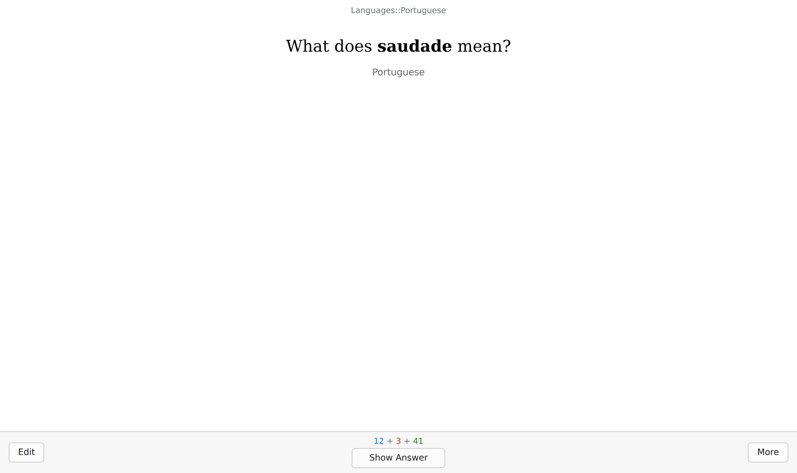
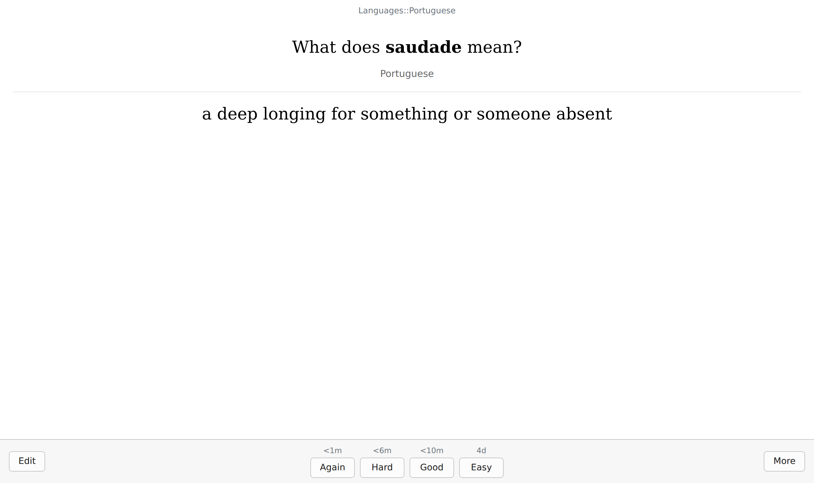
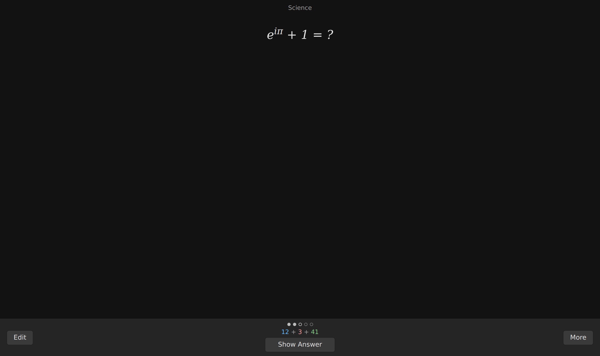
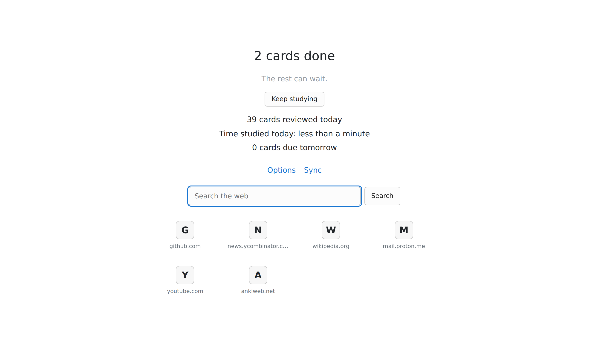
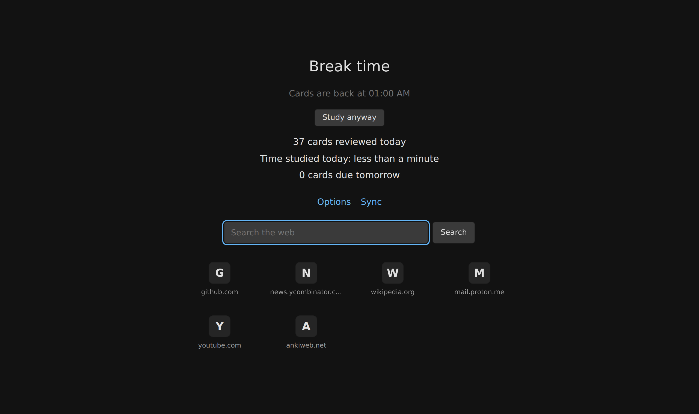
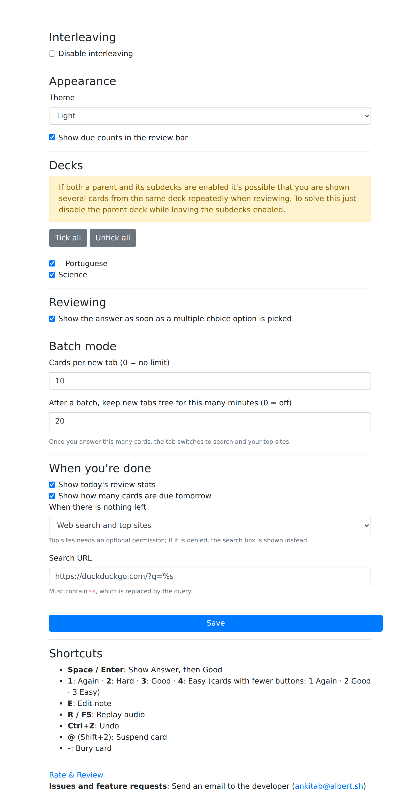

<h1 align="center">
  
  <br>
  AnkiTab
  <br>
</h1>

<h4 align="center">Browser extension that replaces the new tab page with <a href="https://apps.ankiweb.net/" target="_blank">Anki</a> flashcards</h4>

<p align="center">
  <a href="#install">Install</a> •
  <a href="#features">Features</a> •
  <a href="#keyboard">Keyboard</a> •
  <a href="#build">Build</a> •
  <a href="#tests">Tests</a> •
  <a href="#license">License</a>
</p>



Every new tab shows the card Anki would show you next. Answer it the way you would in Anki desktop and the review lands in your collection right away, through the [AnkiConnect](https://ankiweb.net/shared/info/2055492159) add-on.

## Install

1. Install [Anki](https://apps.ankiweb.net/) and the [AnkiConnect](https://ankiweb.net/shared/info/2055492159) add-on. Keep Anki running.
2. **Firefox** (128+): download the latest signed `ankitab-<version>.xpi` from [Releases](https://github.com/tiagov-lab/ankiTab/releases) and open it in Firefox (or drag it onto a Firefox window).
3. **Chrome / Chromium**: build it (see [Build](#build)), open `chrome://extensions`, turn on *Developer mode* and *Load unpacked* the `extension/` folder after `bash build.sh -c`.
4. On first launch, click *Grant permission* so the extension can reach AnkiConnect on `127.0.0.1:8765`.

## Features

- **Anki-native reviewer**: Again / Hard / Good / Easy with next intervals, due counts (new + learning + review), card templates, css, fonts, media, MathJax and card javascript run like in Anki desktop.
- **Batch mode**: each new tab asks for *n* cards, then gets out of your way with search and your top sites. Optionally keep new tabs card-free for a while after a batch.
- **Multiple choice cards**: picking an option shows the answer.
- **Deck rotation**: interleave reviews across decks, exclude the ones you don't want on a new tab.
- **Light, dark or system theme**.
- **Done screen**: today's stats, cards due tomorrow, web search and top sites.
- Edit the note in Anki, undo, suspend, bury and sync from the *More* menu.

| answer | batch progress (dark) |
| --- | --- |
|  |  |
| **batch done** | **break between batches** |
|  |  |

<details>
<summary>options page</summary>


</details>

## Keyboard

| key | action |
| --- | --- |
| `space` / `enter` | show answer, then answer *Good* |
| `1` – `4` | Again / Hard / Good / Easy |
| `e` | edit the note in Anki |
| `r` / `F5` | replay audio |
| `ctrl+z` | undo |
| `@` | suspend card |
| `-` | bury card |

## Build

```bash
git clone https://github.com/tiagov-lab/ankiTab.git
cd ankiTab
bash build.sh       # firefox.zip, chrome.zip and ankitab-firefox.xpi
bash build.sh -f    # copy the firefox manifest into extension/ (load unpacked / about:debugging)
bash build.sh -c    # same for chrome
bash build.sh -i    # regenerate icons from promo/icon.png
```

Release Firefox only installs add-ons signed by Mozilla. For local testing, load `extension/manifest.json` from `about:debugging#/runtime/this-firefox` after `bash build.sh -f` (it stays until Firefox restarts), or use Firefox Developer Edition / Nightly with `xpinstall.signatures.required = false`.

## Tests

The test suite uses vitest with jsdom and runs in docker (no local node needed):

```bash
bash test.sh              # run all tests
bash test.sh --coverage   # with coverage
```

Screenshots in `promo/screenshots/` are generated with Playwright against a fake AnkiConnect: `python3 tools/screenshots.py`.

## Credits

Forked from [corollari/ankiTab](https://github.com/corollari/ankiTab). The main icon comes from [Open Iconic](https://useiconic.com/open).

## License

The Unlicense
